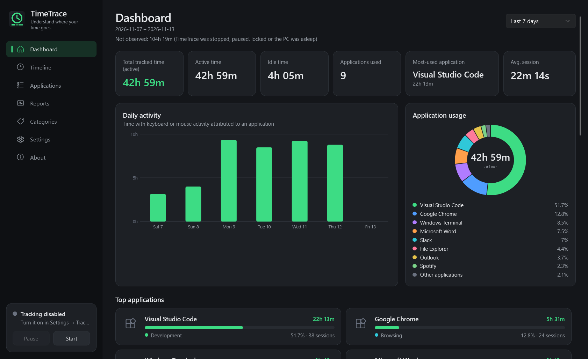
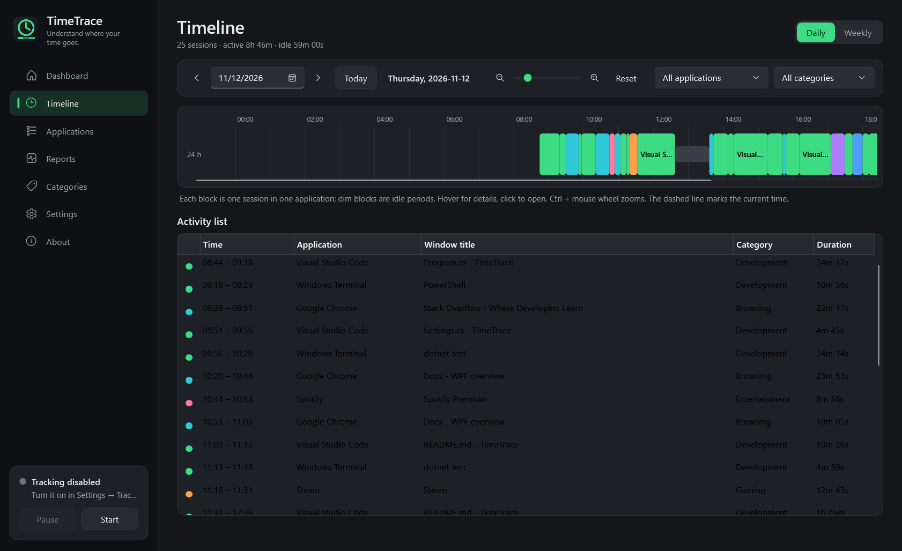
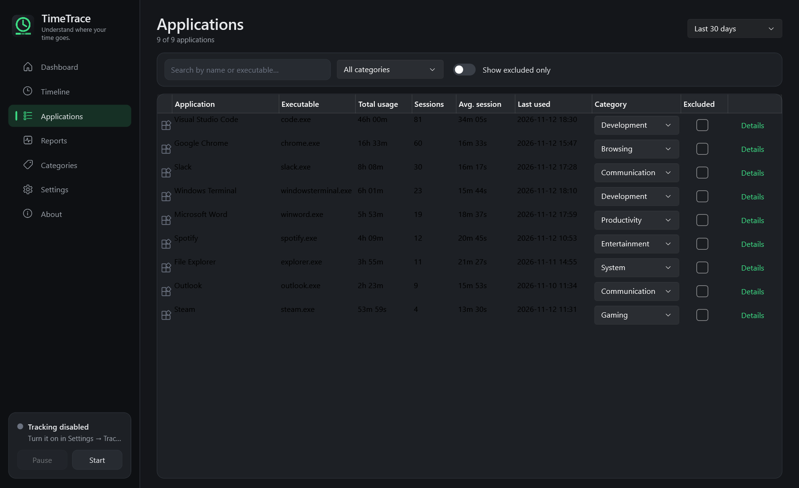
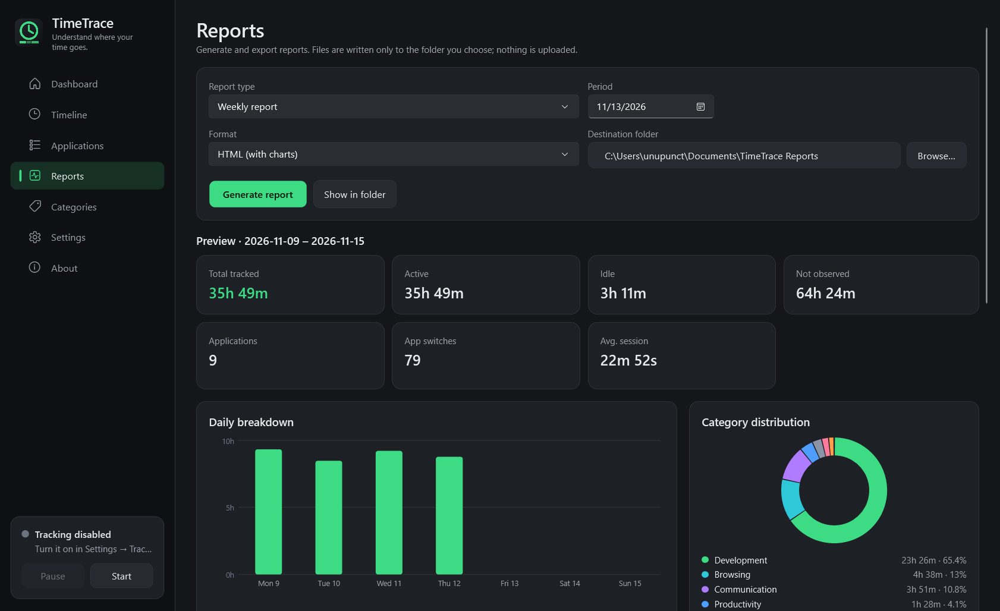
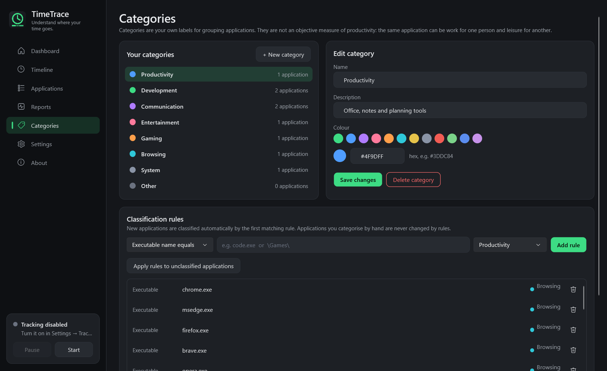

# TimeTrace

**Understand where your time goes.**

TimeTrace is a local-first Windows application that tracks which application is in the foreground, how long you use it, and when you are idle — and turns that into interactive daily and weekly timelines, dashboards and reports. Everything stays on your computer: no account, no cloud, no telemetry.



## Features

- **Automatic tracking** of the active application (name, executable, path, window title) with a 1 s default poll, monotonic-clock durations, and sessions persisted in batches (never one row per poll).
- **Idle detection** (`GetLastInputInfo`, default 5 min, configurable) — idle time is never attributed to an app and can be included in or excluded from reports.
- **Robust**: sleep/resume, lock screen, logoff, crash recovery of unfinished sessions, elevated apps, UWP apps.
- **Dashboard**: totals, top-10 apps, daily/hourly chart, usage distribution, hourly heatmap, category split, recent activity; today / yesterday / 7 / 30 days / custom.
- **Interactive timeline**: 24-hour and weekly views, hover details, click-to-open sessions, zoom, filters by app and category.
- **Applications explorer** with detail pages, custom categories, classification rules and per-app exclusion.
- **Reports** (daily, weekly, monthly, custom, application, category) as CSV, JSON or HTML; full personal-data export; period comparisons.
- **Privacy controls**: pause / stop / disable, exclusions by app, path and window title (substring or `re:` regex), selective or complete deletion, retention period, backup and restore.
- Tray icon, optional notifications, opt-in start with Windows, dark and light themes.

| Timeline | Applications |
|---|---|
|  |  |
| **Reports** | **Categories** |
|  |  |

*(Screenshots use synthetic demo data.)*

## Privacy

TimeTrace records the foreground application, its window title (optional) and idle periods. It never records keystrokes, mouse movement, screenshots, clipboard contents, audio or video, and never sends data anywhere. Categories are your own labels — TimeTrace does not judge whether your time was "productive". Data lives in `%LOCALAPPDATA%\TimeTrace`.

## Install

Download **TimeTrace_Setup.exe** (or the portable **TimeTrace.exe**) from the [Releases](../../releases) page. Windows 10/11 x64; no .NET install needed. The installer is per-user by default (no admin rights), does not start tracking, and does not add startup entries; TimeTrace asks for consent on first run. Binaries are not code-signed, so SmartScreen may warn.

## Build

Requires the .NET 10 SDK and (for the installer) Inno Setup 6.

```powershell
dotnet test tests\TimeTrace.Tests
powershell -File tools\build-release.ps1      # tests, single-file exe, installer -> release\
```

## Architecture

| Project | Responsibility |
|---|---|
| `TimeTrace.Core` | models, tracking engine, analytics, reporting, settings (no UI / OS dependencies) |
| `TimeTrace.Data` | SQLite repository, migrations, backup/restore |
| `TimeTrace.Windows` | Win32 P/Invoke (foreground window, idle), power/session events, startup entry, icons |
| `TimeTrace.App` | WPF + MVVM (CommunityToolkit.Mvvm), custom charts, tray, Serilog logging |
| `TimeTrace.Tests` | xUnit unit, integration and performance tests (Windows APIs are mocked in unit tests) |

## Known limitations

No PDF export (print the HTML report to PDF); English only; elevated apps may lack path/icon; unsigned binaries.

## License

MIT — see [LICENSE.txt](LICENSE.txt).
